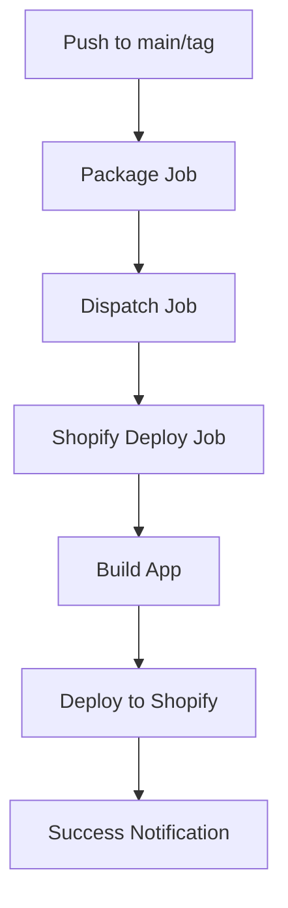

# Shopify App Deployment Guide

This repository contains GitHub Actions workflows for automatically deploying your Shopify app to production and staging environments.

## 🚀 Deployment Workflows

### 1. Automatic Deployment (CD Pipeline)
- **File**: `.github/workflows/cd.yaml`
- **Trigger**: Push to `main` branch or creating a tag (`v*`)
- **Flow**: Build → Package → Deploy to Infrastructure → Deploy to Shopify

### 2. Manual Deployment
- **File**: `.github/workflows/manual-shopify-deploy.yaml`
- **Trigger**: Manual trigger via GitHub Actions UI
- **Use Cases**: Hotfixes, testing, manual deployments

## 🔧 Setup Requirements

### GitHub Secrets
Add these secrets to your GitHub repository settings:

| Secret Name | Description | Required |
|-------------|-------------|----------|
| `SHOPIFY_CLI_PARTNERS_TOKEN` | Partners API token for CLI authentication | ✅ |
| `SHOPIFY_API_KEY` | Your app's API key (Client ID) | ✅ |
| `SHOPIFY_API_SECRET` | Your app's API secret (Client Secret) | ✅ |

### GitHub Variables
Add these variables to your GitHub repository settings:

| Variable Name | Description | Example |
|---------------|-------------|---------|
| `HOST` | Your app's host URL | `https://your-app.com` |
| `SCOPES` | Shopify API scopes | `read_customers,write_products` |
| `NEXT_PUBLIC_API_URL` | Public API URL | `https://api.your-app.com/v1` |
| `NEXT_PUBLIC_IMAGE_PROXY_URL` | Image proxy URL | `https://images.your-app.com` |
| `NEXT_PUBLIC_S3_DOMAIN` | S3 domain for assets | `your-bucket.s3.amazonaws.com` |

### Environment Configuration
Create environment configurations in GitHub:
- **stg** (staging)
- **prod** (production)

Each environment should have its own set of variables and secrets.

## 📋 How to Get Shopify Credentials

### 1. Shopify Partners Token
1. Go to [Shopify Partners Dashboard](https://partners.shopify.com/)
2. Navigate to Settings → API credentials
3. Generate a new API token
4. Add it as `SHOPIFY_CLI_PARTNERS_TOKEN` secret

### 2. App Credentials
1. In your Shopify Partners dashboard, go to your app
2. Copy the **Client ID** → `SHOPIFY_API_KEY`
3. Copy the **Client Secret** → `SHOPIFY_API_SECRET`

## 🎯 Deployment Process

### Automatic Deployment
1. **Staging**: Push to `main` branch
   ```bash
   git push origin main
   ```

2. **Production**: Create and push a tag
   ```bash
   git tag v1.0.0
   git push origin v1.0.0
   ```

### Manual Deployment
1. Go to GitHub Actions in your repository
2. Select "Manual Shopify App Deploy"
3. Click "Run workflow"
4. Choose environment (stg/prod)
5. Select force deploy option if needed

## 🔍 Monitoring Deployments

### Success Indicators
- ✅ All workflow steps complete successfully
- 🚀 App URL is accessible
- 📦 Version information is logged

### Troubleshooting

#### Common Issues:

**1. Authentication Error: "Authorization is required to continue"**
```
Error: Authorization is required to continue, but the current environment does not support interactive prompts.
```
**Solution:**
- Ensure `SHOPIFY_CLI_PARTNERS_TOKEN` is correctly set in GitHub secrets
- Verify the token has the necessary permissions
- Check that `SHOPIFY_API_KEY` and `SHOPIFY_API_SECRET` match your app's credentials

**2. Missing Lock File Error**
```
Error: Dependencies lock file is not found. Supported file patterns: package-lock.json,npm-shrinkwrap.json,yarn.lock
```
**Solution:** This is already fixed in the updated workflows (uses pnpm cache)

**3. Build Failures**
- Check that all environment variables are set correctly
- Verify the build process works locally with `pnpm run build`
- Ensure all dependencies are properly installed

**General Troubleshooting:**
- Check GitHub Actions logs for detailed error messages
- Verify all secrets and variables are correctly set
- Ensure Shopify Partners token has necessary permissions
- Confirm app configuration in `shopify.app.toml` is correct

## 🏗️ Workflow Architecture



## 📝 Configuration Files

- `shopify.app.toml` - Main app configuration
- `web/shopify.web.toml` - Web component configuration
- `.github/workflows/` - Deployment workflows

## 🚨 Important Notes

1. **Force Deploy**: The `--force` flag skips confirmations in CI/CD
2. **Environment Separation**: Use different Shopify apps for staging and production
3. **Secrets Security**: Never commit secrets to the repository
4. **Build Process**: Ensure your app builds successfully before deployment
5. **Host URL**: Update `application_url` in `shopify.app.toml` for each environment

## 🔄 Rollback Strategy

To rollback a deployment:
1. Use manual deployment workflow
2. Deploy the previous working commit/tag
3. Or use `shopify app generate` to create a new version

## 📞 Support

For issues with:
- **GitHub Actions**: Check repository settings and logs
- **Shopify CLI**: Visit [Shopify CLI documentation](https://shopify.dev/docs/apps/tools/cli)
- **App Deployment**: Contact Shopify Partners support 